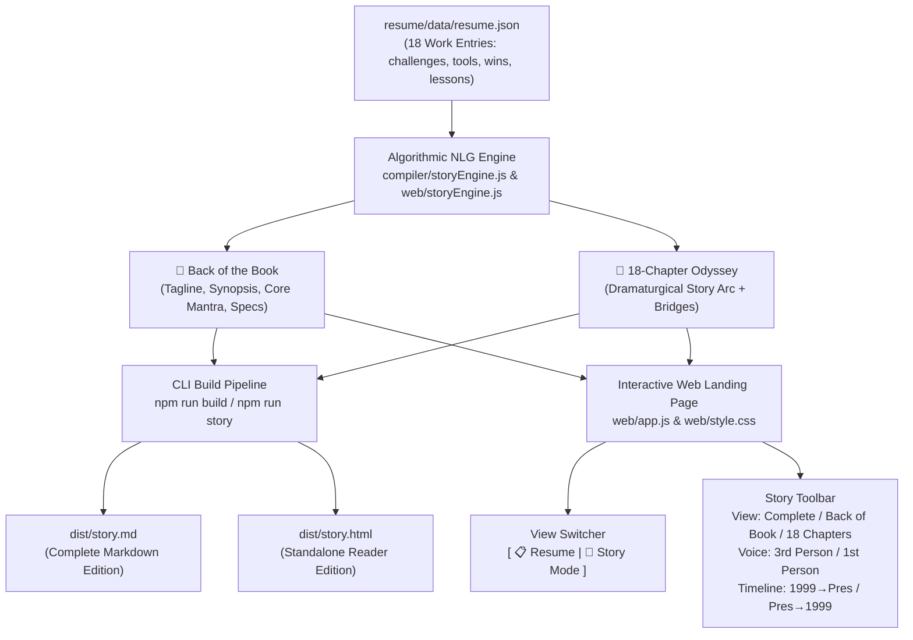

# TalentScout — Career Story & "Back of the Book" Handoff

> **Session Conversation ID:** `38d6e386-b76c-4892-aefb-a98099b5c44c`  
> **Date:** October 31, 2026  
> **Workspace:** `D:\DevWorkspace\TalentScout`  
> **Status:** ✅ Fully Implemented, Verified, and Staged (38/38 Tests Passing)  

---

## 1. Executive Summary

This session designed, implemented, and verified an **Algorithmic Natural Language Generation (NLG)** engine that transforms the user's structured living resume (`resume/data/resume.json`) into an editorial-grade **Career Story Odyssey** and an executive **"Back of the Book"** jacket summary—**100% offline, deterministic, and without requiring any LLM**.

The system translates 18 career eras spanning 26+ years (from Nintendo of America and original Xbox console testing to enterprise Windows OS, cloud APIs at Smartsheet, and modern AI agent pipelines) into an engaging dramaturgical narrative.



---

## 2. Core Architectural Decisions

### A. Non-LLM Natural Language Generation (NLG)
- **Zero Hallucinations:** Every milestone, metric, tool, and challenge strictly derives from `resume.json`.
- **Zero Dependency / Offline:** Instant generation in CI/CD, build scripts, or client browsers without API keys or token costs.
- **Combinatorial Variation Banks:** Anti-repetition banks rotate opening hooks, obstacle framing, strategic phrasing, victory declarations, and transitions so chapters feel natural and diverse.

### B. Dramaturgical Arc Mapping
Each work entry is structured across classic narrative beats:
1. **The Hook & Setting:** Role, company, location, and dates.
2. **The Inciting Conflict / Crucible:** Technical obstacles and organizational friction (`challenges`).
3. **The Quest & Strategy:** Tooling and methodology deployed (`toolsUsed`, `skillsUsed`).
4. **The Climax & Breakthrough:** Quantifiable victories and deliverables (`wins`, `highlights`).
5. **The Moral / Core Takeaway:** Enduring wisdom gained (`lessonsLearned`), styled as callout quotes.
6. **Chronological Bridges:** Contextual connective tissue pointing to the next role in time.

### C. The "Back of the Book" Jacket Summary
Designed after a hardcover biography slipcase:
- **Hero Tagline:** *"From cartridge burners and bare-metal debuggers to cloud APIs and autonomous AI agents: 26+ years on the software quality frontier."*
- **3-Paragraph Synopsis:** Setting the stakes, highlighting the recurring crucible of manual bottlenecks, and articulating the leadership philosophy.
- **Core Mantra Callout:** *"Quality is never an afterthought or a bureaucratic gate. It is an active discipline engineered into every commit—freeing developers to build with unwavering confidence."*
- **Edition Specs & Vital Metrics:** 18 Chapters, 26+ Years, 0 → 1,500+ Automated Tests, 85% Manual Coverage Replaced, 100% LLM-Free.
- **Edition Metadata Bar:** Genre classification, ISBN mock, and publisher credits.

### D. Dual-Perspective & Flexible Timeline
- **Perspective:** Switchable between `3rd person` (biography / speaker bio) and `1st person` (personal portfolio / interview narrative).
- **Order:** Switchable between `chronological` (1999 → Present) and `reverse` (Present → 1999).

---

## 3. Files Created & Modified

| File | Change Type | Description |
|---|---|---|
| [resume/compiler/storyEngine.js](file:///d:/DevWorkspace/TalentScout/resume/compiler/storyEngine.js) | **Created** | Standalone Node.js ESM module & CLI runner for generating chapters, "Back of the Book" synopsis, Markdown, and standalone HTML. |
| [resume/compiler/build.js](file:///d:/DevWorkspace/TalentScout/resume/compiler/build.js) | **Modified** | Integrated `storyEngine.js` into the default build step; outputs `dist/story.md` and `dist/story.html` on every `npm run build`. |
| [resume/web/storyEngine.js](file:///d:/DevWorkspace/TalentScout/resume/web/storyEngine.js) | **Created** | Browser-compatible NLG engine exposing `window.StoryEngine`. |
| [resume/web/app.js](file:///d:/DevWorkspace/TalentScout/resume/web/app.js) | **Modified** | Contains embedded story engine fallback, live View Mode switcher (`Resume` vs `Story Mode`), and interactive controls (`View`, `Voice`, `Timeline`, `Download Story .md`). |
| [resume/web/style.css](file:///d:/DevWorkspace/TalentScout/resume/web/style.css) | **Modified** | Added dark glassmorphism styling for `.story-back-of-book` book jacket, timeline rails, gold badges, takeaway callouts, and responsive layouts. |
| [resume/web/index.html](file:///d:/DevWorkspace/TalentScout/resume/web/index.html) | **Modified** | Added `<script src="storyEngine.js" defer></script>`. |
| [index.html](file:///d:/DevWorkspace/TalentScout/index.html) | **Modified** | Added `<script src="resume/web/storyEngine.js" defer></script>` to root landing page. |
| [resume/dist/story.md](file:///d:/DevWorkspace/TalentScout/resume/dist/story.md) | **Generated** | Compiled Markdown edition featuring "Back of the Book", Prologue, 18 Chapters, and Epilogue. |
| [resume/dist/story.html](file:///d:/DevWorkspace/TalentScout/resume/dist/story.html) | **Generated** | Standalone reader edition with styled book jacket and serif typography. |
| [resume/tests/compiler.test.js](file:///d:/DevWorkspace/TalentScout/resume/tests/compiler.test.js) | **Modified** | Added 6 tests for story outputs, chapter completeness, 1st-person voice, and Back of the Book integrity (**38/38 passing**). |
| [resume/package.json](file:///d:/DevWorkspace/TalentScout/resume/package.json) | **Modified** | Added scripts: `"story": "node compiler/storyEngine.js"`, `"story:first": "node compiler/storyEngine.js --first"`. |
| [resume/deploy/](file:///d:/DevWorkspace/TalentScout/resume/deploy/) | **Updated** | Staged production assets via `npm run deploy:stage`. |
| [resume/CONTEXT.md](file:///d:/DevWorkspace/TalentScout/resume/CONTEXT.md) | **Modified** | Recorded Milestone M7 completion and updated file index. |

---

## 4. Verification & Test Matrix

All **38 automated tests** pass cleanly:

```powershell
cd D:\DevWorkspace\TalentScout\resume
npm test
```

```
 RUN  v1.6.1 D:/DevWorkspace/TalentScout/resume

 ✓ tests/schema.test.js  (17 tests) 39ms
 ✓ tests/compiler.test.js  (21 tests) 8971ms

 Test Files  2 passed (2)
      Tests  38 passed (38)
   Duration  11.36s
```

### Verified Checks:
1. `dist/story.md` exists and contains candidate name, `## 📕 Back of the Book`, `## Prologue`, all 18 chapters (`## Chapter 1:` through `## Chapter 18:`), and `## Epilogue`.
2. `dist/story.html` is valid HTML with `back-of-book-card`, `lesson-callout`, and zero literal `undefined` or `null` strings.
3. `generateBackOfTheBook()` generates accurate metrics (`26 years, 4 months`, `18 Work Eras`, `0 → 1,500+ Tests`, `85% Automated`).
4. Dual-perspective rendering generates appropriate pronouns (`"In Nov 2021, Thomas S. Snyder stepped into..."` vs `"In Nov 2021, I stepped into..."`).
5. Client-side self-contained engine in `web/app.js` renders synchronously even if `storyEngine.js` fails to load.

---

## 5. Quick Command Reference

```bash
cd D:\DevWorkspace\TalentScout\resume

# 1. Run full build (compiles resume.md, resume.html, story.md, story.html)
npm run build

# 2. Run standalone story engine (Third-person, chronological)
npm run story

# 3. Run standalone story engine in First-person voice ("I / My")
npm run story:first

# 4. Run test suite
npm test

# 5. Stage web deployment
npm run deploy:stage

# 6. Deploy to GitHub Pages (when ready)
npm run deploy
```

---

## 6. Recommended Next Steps for Future Sessions

1. **Story PDF Compilation (`dist/story.pdf`):**
   - Add a `--story-pdf` flag to `compiler/build.js` using Puppeteer to render `dist/story.html` into a printable booklet PDF.
2. **MCP Tool Integration:**
   - Expose `get_career_story` in `resume/mcp-server/src/index.ts` with parameters `perspective?: 'first' | 'third'` and `format?: 'markdown' | 'back-of-book' | 'summary'`.
3. **Audio Narration / Podcast Overview:**
   - Integrate with the local TTS / Sorceress voice synthesis tool to generate an audio narrative or "radio play" trailer of the Back of the Book blurb.
